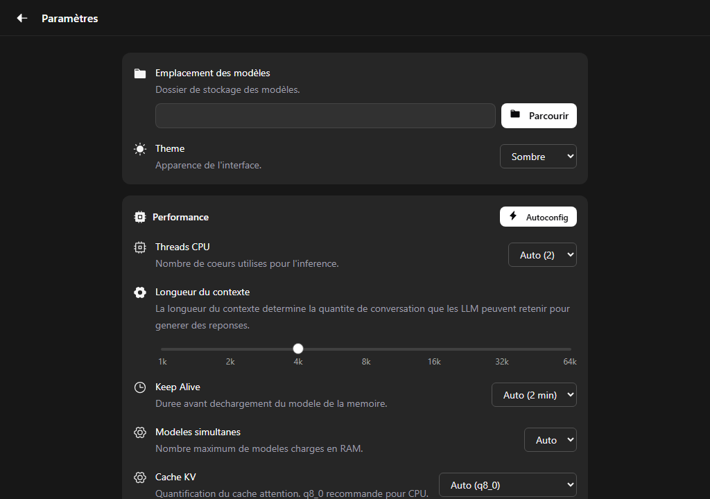

<p align="center">
  
</p>

<h1 align="center">Dromadaire</h1>

<p align="center">
  <strong>Assistant IA local et confidentiel</strong><br>
  Zero telemetrie &bull; Zero cloud &bull; 100% hors-ligne
</p>

<p align="center">
  <a href="https://github.com/ayinedjimi/dromadaire/releases/latest"></a>
  <a href="LICENSE"></a>
  <a href="https://github.com/ayinedjimi/dromadaire/releases"></a>
  
</p>

<p align="center">
  <a href="#-fonctionnalites">Fonctionnalites</a> &bull;
  <a href="#-installation">Installation</a> &bull;
  <a href="#-captures-decran">Captures d'ecran</a> &bull;
  <a href="#-guide-rapide">Guide rapide</a> &bull;
  <a href="#-architecture">Architecture</a> &bull;
  <a href="#-build">Build</a>
</p>

---

## Qu'est-ce que Dromadaire ?

Dromadaire est un fork confidentialite d'[Ollama](https://ollama.com) concu pour les professionnels et les entreprises qui veulent exploiter les LLM **sans jamais envoyer une seule donnee sur Internet**.

Developpe par [AYI NEDJIMI Consultants](https://ayinedjimi-consultants.fr), specialiste en intelligence artificielle et conseil numerique.

> *Votre IA, sur votre machine, avec vos donnees. Point final.*

---

## Fonctionnalites

### Confidentialite native
- **Zero telemetrie** — aucun appel reseau, aucun tracking, aucun analytics
- **Chiffrement AES-256-GCM** des conversations et documents
- **Mode incognito** — conversations ephemeres non sauvegardees
- **Mode portable** — tout dans un dossier, rien dans le registre
- **Sandbox iframe** — execution de code isolee, sans acces au DOM parent

### Interface desktop moderne
- **6 themes** — Light, Dark, OLED, Sepia, Blue Night, Nord
- **Panneau lateral redimensionnable** — contexte, parametres, preview
- **Preview d'artifacts** — HTML, CSS, JavaScript, SVG, Mermaid, CSV, JSON, Markdown
- **Execution JavaScript** — rendu en temps reel dans un iframe sandboxe
- **Editeur Monaco** — coloration syntaxique pour 20+ langages
- **Export HTML** — conversations exportables avec rendu complet

### Intelligence augmentee (RAG)
- **Pipeline RAG local** — embedding avec `snowflake-arctic-embed:33m`
- **Base de connaissances** — indexation de documents (PDF, TXT, MD, DOCX)
- **Recherche semantique** — chunks 256 mots, overlap 30, SIMD accelere
- **Gestion de fichiers** — drag & drop, preview, suppression

### Performance optimisee CPU
- **Quantification KV Q4_0** — +10.4% de debit sur CPU
- **Configuration auto** — detection des threads, cache, context optimal
- **12 parametres avances** — temperature, top_p, top_k, repeat_penalty, mirostat...
- **Moniteur systeme** — RAM, CPU, tokens/sec en temps reel
- **Vulkan switchable** — selecteur runtime CPU/iGPU

### Outils avances
- **Arena LLM** — comparaison cote a cote de 3 modeles avec LLM-as-Judge
- **Auto-titre** — generation automatique des titres de conversation
- **Structured output** — reponses JSON avec schema validation
- **Branching** — arborescence de conversations alternatives
- **Context overflow** — gestion intelligente du depassement de contexte
- **Suggestions de suivi** — propositions de questions pertinentes

---

## Captures d'ecran

<p align="center">
  
  <br><em>Parametres — Performance, themes, configuration des threads CPU</em>
</p>

### Modeles pre-installes

L'installeur inclut deux modeles prets a l'emploi :

| Modele | Taille | Usage |
|--------|--------|-------|
| `tinyllama` | 608 Mo | Chat rapide, ideal pour tester |
| `snowflake-arctic-embed:33m` | 64 Mo | Embedding pour le RAG |

---

## Installation

### Installeur Windows (recommande)

Telechargez le dernier installeur depuis la [page Releases](https://github.com/ayinedjimi/dromadaire/releases/latest) :

1. Telechargez `DromadaireSetup.exe`
2. Lancez l'installeur (aucun droit administrateur requis)
3. Dromadaire s'installe dans `%LOCALAPPDATA%\Programs\Dromadaire`

### Mode portable

1. Telechargez `dromadaire-portable.zip` depuis les [Releases](https://github.com/ayinedjimi/dromadaire/releases/latest)
2. Decompressez dans le dossier de votre choix
3. Creez un fichier `portable.marker` a cote de `dromadaire.exe`
4. Lancez `dromadaire.exe` — les donnees resteront dans `./data/` et les modeles dans `./models/`

### Configuration requise

| Composant | Minimum | Recommande |
|-----------|---------|------------|
| OS | Windows 10 (64-bit) | Windows 11 |
| CPU | x86-64 (SSE4.2) | x86-64 (AVX2) |
| RAM | 8 Go | 16 Go+ |
| Stockage | 2 Go + modeles | SSD NVMe |

---

## Guide rapide

### Premier lancement

1. Lancez Dromadaire — l'interface s'ouvre dans une fenetre desktop
2. Cliquez sur **Telecharger un modele** pour installer votre premier LLM
3. Modeles recommandes pour 16 Go RAM :
   - `llama3.2:3b` — rapide, polyvalent (2 Go)
   - `qwen2.5:7b` — excellent en francais (4.7 Go)
   - `gemma3:4b` — bon equilibre qualite/vitesse (3 Go)

### Mode incognito

Cliquez sur l'icone en haut a droite pour basculer en mode incognito. Les messages ne seront pas sauvegardes.

### Base de connaissances (RAG)

1. Allez dans **Connaissances** via le menu lateral
2. Glissez-deposez vos documents (PDF, TXT, MD, DOCX)
3. L'embedding se fait automatiquement avec `snowflake-arctic-embed:33m`
4. Posez des questions — Dromadaire cherchera dans vos documents

### Preview d'artifacts

Quand un LLM genere du code HTML, JavaScript, SVG ou Mermaid, un bouton **Apercu** apparait sous le bloc de code. Cliquez pour voir le rendu en temps reel.

### Parametres de performance

Ouvrez **Parametres > Performance** pour ajuster :
- **Threads CPU** — `Auto` detecte le nombre optimal
- **Longueur du contexte** — 2048 recommande pour 16 Go RAM
- **Cache KV** — `Q4_0` pour le meilleur debit CPU
- **Keep Alive** — duree de vie du modele en memoire

---

## Architecture

```
dromadaire/
  api/          # API REST compatible Ollama
  app/
    cmd/app/    # Point d'entree GUI (webview)
    store/      # SQLite + chiffrement AES + RAG
    tools/      # Web fetch, bash (sandbox)
    ui/app/     # Frontend React/TypeScript (Vite)
      src/
        components/   # Chat, Settings, RAG, Arena, Preview...
        lib/          # Renderers, utilitaires
  cmd/          # CLI ollama (moteur)
  llm/          # Backend llama.cpp (CPU/Vulkan)
  server/       # Serveur HTTP d'inference
```

### Stack technique

| Couche | Technologie |
|--------|-------------|
| Backend | Go 1.24+, llama.cpp (C/C++) |
| Frontend | React 19, TypeScript, Vite 6, TailwindCSS |
| Editeur | Monaco Editor |
| Database | SQLite (schema v26) |
| Embedding | snowflake-arctic-embed:33m |
| Chiffrement | AES-256-GCM (Go crypto/aes) |
| Runtime | llama.cpp CPU (AVX2/Haswell) + Vulkan optionnel |

---

## Build

### Prerequis

- Go 1.24+
- Node.js 20+
- CMake 3.24+
- Visual Studio Build Tools (MSVC)

### Compilation

```bash
# 1. Frontend (OBLIGATOIRE en premier)
cd app/ui/app
npx vite build

# 2. Backend GUI
cd ../../..
go build -trimpath -ldflags "-s -w -H windowsgui" -buildvcs=false -o dist/dromadaire.exe ./app/cmd/app/

# 3. (Optionnel) Installeur Inno Setup
"C:\Program Files (x86)\Inno Setup 6\ISCC.exe" /DARCH=amd64 app/dromadaire.iss
```

> **Piege courant** : `go build .` compile le CLI Ollama, pas l'interface Dromadaire. Utilisez toujours `go build ./app/cmd/app/`.

---

## Comparaison

| Fonctionnalite | Dromadaire | Ollama | LM Studio | GPT4All |
|----------------|:----------:|:------:|:---------:|:-------:|
| Zero telemetrie | **Oui** | Non | Non | Partiel |
| Interface desktop | **Oui** | Non | Oui | Oui |
| Chiffrement conversations | **AES-256** | Non | Non | Non |
| Mode incognito | **Oui** | Non | Non | Non |
| RAG local | **Oui** | Non | Plugin | Oui |
| Preview artifacts | **Oui** | Non | Non | Non |
| Execution JavaScript | **Oui** | Non | Deno (texte) | Non |
| Arena LLM | **Oui** | Non | Non | Non |
| Mode portable | **Oui** | Non | Non | Non |
| Open source | **MIT** | MIT | Non | GPL |

---

## Liens utiles

- [AYI NEDJIMI Consultants](https://ayinedjimi-consultants.fr) — Conseil en IA et transformation numerique
- [RAG en 2026 : Guide Architecture & Chunking](https://ayinedjimi-consultants.fr/ia-rag-retrieval-augmented-generation) — Comment fonctionne le RAG utilise dans Dromadaire
- [IA & Developpement](https://ayinedjimi-consultants.fr/ia-developpement) — Intelligence artificielle au service de la cybersecurite
- [Multi-Agent Orchestration 2026](https://ayinedjimi-consultants.fr/multi-agent-orchestration-2026) — Patterns et frameworks IA
- [Jailbreak & Prompt Hacking LLM](https://ayinedjimi-consultants.fr/jailbreak-prompt-hacking-llm-2026) — Pourquoi l'execution locale est plus sure
- [Detection de fraude & Deepfakes](https://ayinedjimi-consultants.fr/ia-detection-fraude-deepfakes-2026) — IA appliquee a la securite
- [Donnees synthetiques pour LLM](https://ayinedjimi-consultants.fr/donnees-synthetiques-llm-2026) — Methodes d'entrainement
- [Ollama](https://ollama.com) — Moteur d'inference upstream

---

## Credits

Dromadaire est un fork de [Ollama](https://github.com/ollama/ollama) (MIT License).
Developpe par [AYI NEDJIMI Consultants](https://ayinedjimi-consultants.fr) — *INTELLIGENCE PRIVEE*.

## Licence

[MIT](LICENSE) — Libre d'utilisation, de modification et de distribution.

## Documentation technique

- [ARCHITECTURE.md](ARCHITECTURE.md) : architecture du code et intégration des moteurs (dont `lamazero.dll`).
- [docs/TEST_PLAN.md](docs/TEST_PLAN.md) : plan de tests et commandes.
